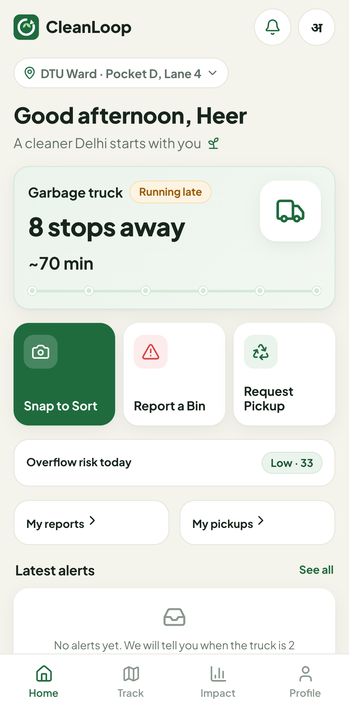
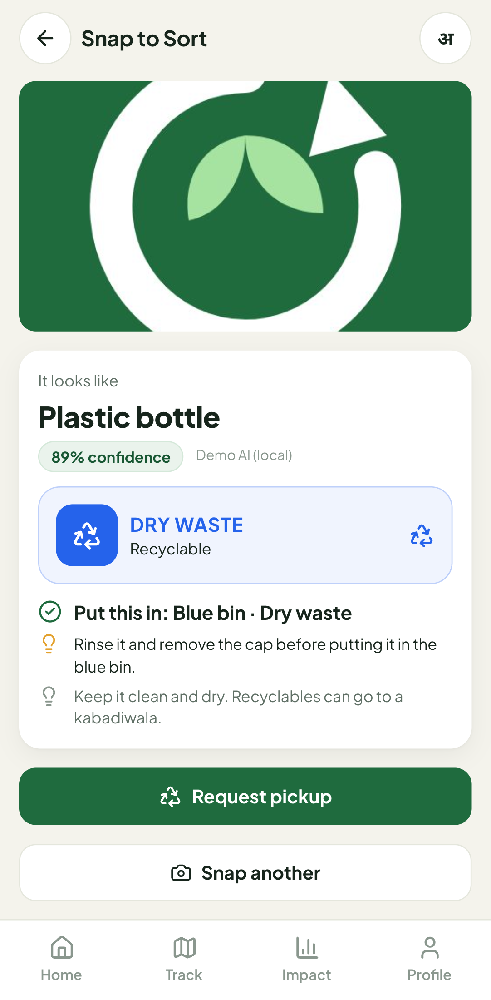
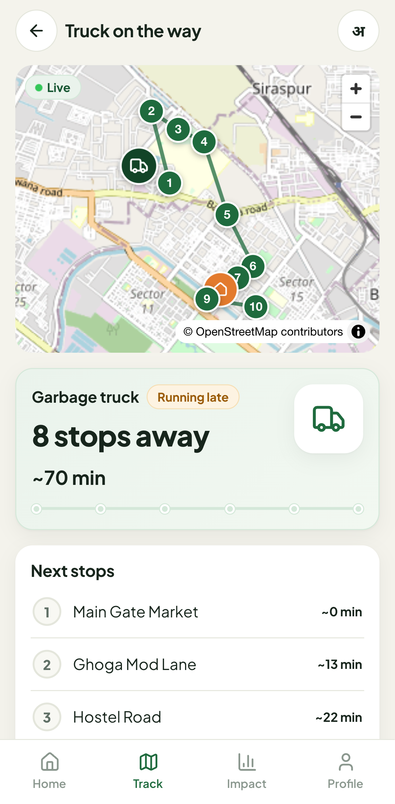
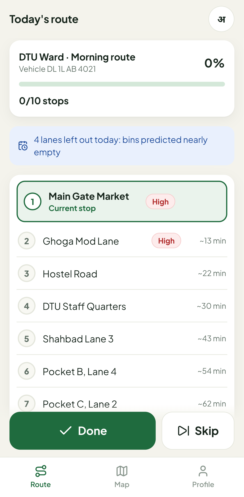
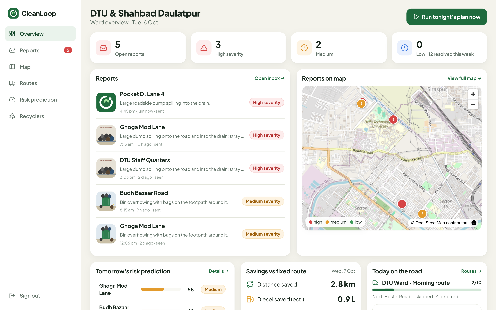
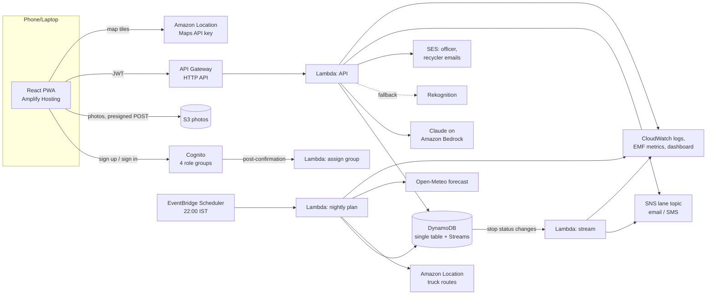

# CleanLoop

**Sort right. Know when the truck comes. Report overflowing bins. Send recyclables to a kabadiwala. Run smarter garbage routes.**

CleanLoop is one mobile-first web app with four roles (resident, truck driver, ward officer and recycler) that closes the household-waste loop for a Delhi ward. Built by Team Git Happens for **Environmental Hacks 2026 (Bharat Builds Tour, Event 02), Track 03: Waste and Energy**, on AWS.

<p>
  
  
  
  
</p>


## The problem

- **Mixed waste at source.** Since April 2026, India's Solid Waste Management Rules require four-stream segregation (wet, dry, sanitary, special care), yet most households don't know which bin an item belongs in.
- **Reactive collection.** Bins overflow, residents can't tell when the truck will come, and complaints disappear.
- **Fixed routes.** Trucks drive the same route whether a lane needs a pickup or not, burning diesel and adding CO₂.
- **Invisible recyclers.** Kabadiwalas already move a large share of recyclables and e-waste, but residents can't find them digitally.

## The loop

| Step                    | What happens                                                                                                                                                                                                                                                                  | AWS                                                                                               |
| ----------------------- | ----------------------------------------------------------------------------------------------------------------------------------------------------------------------------------------------------------------------------------------------------------------------------- | ------------------------------------------------------------------------------------------------- |
| **1. Sort**             | A resident photographs an item. Claude returns the stream (wet, dry, sanitary, special care, or e-waste), the bin and a one-line tip in English or Hindi. Unsure photos ask for a retake or a manual choice instead of guessing. Recyclables get a **Request pickup** button. | S3 presigned upload → Lambda → **Claude on Amazon Bedrock** (Rekognition fallback)                |
| **2. Collect**          | The driver taps **Done** or **Skip** (with a reason). Residents see a live ETA ("3 stops away, ~25 min"), are alerted when the truck is 2 stops away, and are told if their lane was missed.                                                                                  | API Gateway → Lambda → DynamoDB **Streams** → Lambda → **SNS** (email/SMS) + in-app feed          |
| **3. Report**           | A photo of an overflowing bin or dump is triaged for severity, located to the ward and lane by GPS, and emailed to the ward officer with the photo and a map link. The resident tracks it from Sent to Seen to Resolved, including the officer's after-photo.                 | S3 → Lambda → Bedrock → DynamoDB → **SES**                                                        |
| **4. Predict and save** | Every night at 22:00 IST each lane gets an overflow-risk score. Tomorrow's route visits high-risk lanes first and defers lanes predicted to be nearly empty. The dashboard shows km, diesel and CO₂ saved against the fixed route.                                            | **EventBridge Scheduler** → Lambda → **Amazon Location** truck routing + Open-Meteo rain forecast |
| **5. Recycle**          | Pickup requests are matched to the nearest registered recycler who buys that material. Recyclers accept (first one wins) and mark jobs done; residents see who is coming and can call them.                                                                                   | Lambda + DynamoDB conditional writes + SES                                                        |

## Features by role

**Resident (phone, English/हिन्दी).** Lane selector; weather and air quality (PM2.5 on India's AQI bands); truck ETA card; Snap to Sort; report a bin with auto-location; status tracker with after-photo; request a recycler pickup; lane alerts by email or SMS; personal and ward impact.

**Driver (phone, big buttons, Hindi by default).** Today's route in order with the current stop highlighted, progress bar, large Done and Skip buttons (Skip asks for a reason), map with numbered stops and one-tap Google Maps navigation, and the lanes deferred today.

**Ward officer (laptop).** Severity-ranked reports inbox with photo, AI triage, hazards, map link and **Resolve with after-photo**; map of open reports and today's route; tomorrow's risk list with a per-factor breakdown; proposed route against the old fixed route; savings card; recycler directory; demo tools.

**Recycler (phone).** Register a shop (materials, ₹/kg rates, location, consent to share name and phone); nearby open requests with photo, distance and a "Matched to you" badge; accept; My jobs with call, map and Mark done.

## How the intelligence works

**Sorting and triage.** The Lambda sends the (client-compressed, 1600 px) photo to Claude through the Anthropic SDK's Bedrock client and asks it to answer with a tool call (`record_sort` / `record_severity`). Every answer is validated with Zod. If the configured model is unavailable or declines, the next model is tried (default `anthropic.claude-opus-5-5`, then `anthropic.claude-haiku-4-5`, then `global.anthropic.claude-sonnet-4-6` through the older InvokeModel API for accounts that only have that), then Rekognition labels mapped to bins by rules. A report is never dropped because a model is down: it goes to the officer marked "triage unavailable".

**ETA.** `ETA(stop k) = time of the last completed stop + Σ avgMinutesToNext` for the stops in between, recalculated on every tap. A truck can't arrive in the past, so an overdue schedule restarts from "now" and shows _Running late_. Driver taps drive the demo, not live GPS.

**Overflow risk (0–100 per lane per day).**

| Factor                                              | Weight | Saturates at |
| --------------------------------------------------- | ------ | ------------ |
| Past overflow reports on the same weekday (8 weeks) | 30%    | 2 reports    |
| Days since the last completed pickup                | 25%    | 3 days       |
| Missed or skipped stops in the last 7 days          | 20%    | 2 misses     |
| Rain forecast (Open-Meteo: probability and mm)      | 15%    | 100% / 10 mm |
| Market day (per lane) or festival (per ward)        | 10%    | yes/no       |

Under 35 is low, 35–65 medium, above 65 high. `npm run backtest` replays history and compares weight settings by AUC and top-3 hit rate. On the synthetic demo history the brief's weights give AUC ≈ 0.79 against a 9.7% base rate. Re-run it on real ward data before trusting the numbers.

**Route and savings.** High-risk lanes go first in nearest-neighbour order, then the rest. A lane is deferred only if it scores under 20, was collected within a day, has no open report and no event, and never more than a third of the route. Both routes are measured the same way (Amazon Location truck routing, or straight-line × 1.35 when offline). Diesel = km saved ÷ 3 km/L and CO₂ = litres × 2.68 kg/L; the app labels both as **estimates** and states the assumptions.

## Architecture



Infrastructure is one SAM template ([`infra/template.yaml`](infra/template.yaml)). More detail: [docs/ARCHITECTURE.md](docs/ARCHITECTURE.md).

| AWS service                     | Role in CleanLoop                                                                              |
| ------------------------------- | ---------------------------------------------------------------------------------------------- |
| Amplify Hosting                 | Hosts the installable PWA                                                                      |
| Cognito                         | Sign-up/sign-in; groups for resident, driver, officer, recycler                                |
| API Gateway (HTTP API) + Lambda | All API routes, with a JWT authorizer                                                          |
| Amazon Bedrock (Claude)         | Item classification and bin-severity triage, in English or Hindi                               |
| Rekognition                     | Fallback classifier and triage                                                                 |
| DynamoDB + Streams              | Single-table data; a stop's status change triggers resident alerts                             |
| S3                              | Photos, uploaded by the browser through presigned POST (size and type enforced by S3)          |
| SNS                             | Per-lane alerts (one topic, filter policy per lane)                                            |
| SES                             | Officer emails with the photo inline; recycler and resident updates                            |
| EventBridge Scheduler           | Nightly risk and route planning at 22:00 Asia/Kolkata                                          |
| Amazon Location Service         | Truck routing for the savings comparison; map tiles with India's official boundaries           |
| CloudWatch                      | Logs (14-day retention), custom metrics through Embedded Metric Format, dashboard, error alarm |
| SAM / CloudFormation            | Infrastructure as code (SAM CLI is one of the AWS open-source tools)                           |

## Documentation

| Guide                                          | Read it to…                                                                                                   |
| ---------------------------------------------- | ------------------------------------------------------------------------------------------------------------- |
| [docs/LOCAL_SETUP.md](docs/LOCAL_SETUP.md)     | Run the whole app on your laptop with no AWS account; mock-AI file names; phone testing                       |
| [AWS_SETUP.md](AWS_SETUP.md)                   | Prepare the AWS account: region, the `cleanloop` profile, exact IAM permissions, Bedrock/SES/SNS steps, costs |
| [docs/DEPLOYMENT.md](docs/DEPLOYMENT.md)       | Deploy with one command, verify it, redeploy, add users, tear down                                            |
| [docs/CONFIGURATION.md](docs/CONFIGURATION.md) | Look up every environment variable, template parameter and tunable constant                                   |
| [docs/TESTING.md](docs/TESTING.md)             | Run unit, integration, DynamoDB Local, end-to-end and template checks; the manual test plan                   |
| [docs/DEVELOPMENT.md](docs/DEVELOPMENT.md)     | Find your way around the code; recipes for endpoints, screens, translations, AI and data changes              |
| [docs/RUNBOOK.md](docs/RUNBOOK.md)             | Operate the deployed app: logs, metrics, manual nightly run, demo-day checklist, incidents                    |
| [docs/ARCHITECTURE.md](docs/ARCHITECTURE.md)   | Request flows, the DynamoDB data model, security notes                                                        |
| [docs/DEMO_SCRIPT.md](docs/DEMO_SCRIPT.md)     | Record the 3-minute demo video                                                                                |

## Quick start

Run locally (no AWS account needed; Node.js 20.19+):

```bash
npm ci
npm run dev            # API on :8787 (in-memory data, mock AI) + web app on http://localhost:5173
```

Open http://localhost:5173 and use the demo buttons. The local mock AI picks its answer from the photo's file name (`banana.jpg` → wet, `phone.jpg` → e-waste, `blurry.jpg` → manual choice, `dump.jpg` → high severity; full table in [LOCAL_SETUP.md](docs/LOCAL_SETUP.md#the-mock-ai-reads-file-names)).

Deploy to AWS (after [AWS_SETUP.md](AWS_SETUP.md)):

```bash
AWS_PROFILE=cleanloop AWS_REGION=ap-south-1 SENDER_EMAIL=you@gmail.com npm run check:aws
AWS_PROFILE=cleanloop SENDER_EMAIL=you@gmail.com OFFICER_EMAIL=you+officer@gmail.com npm run deploy
```

The deploy builds the Lambdas, deploys the stack, seeds demo users and the DTU demo ward, builds the web app and publishes it to Amplify, then prints the URL. Details: [DEPLOYMENT.md](docs/DEPLOYMENT.md).

## Checks

| Command                                                 | What it covers                                                                                                                                                                                           |
| ------------------------------------------------------- | -------------------------------------------------------------------------------------------------------------------------------------------------------------------------------------------------------- |
| `npm run check`                                         | Typecheck, lint, all tests, production build                                                                                                                                                             |
| `npm test`                                              | 111 unit and integration tests: ETA, risk, planner, savings, alert rules, AI parsing and fallbacks, DynamoDB expressions, S3/SNS/SES/Location adapters, and every API flow end to end through the router |
| `npm run test:dynamo`                                   | The API flows against DynamoDB Local (Docker)                                                                                                                                                            |
| `npm run e2e`                                           | Playwright: all four roles through the real UI in a phone-sized browser                                                                                                                                  |
| `npm run backtest`                                      | Risk-score backtest across weight settings                                                                                                                                                               |
| `cfn-lint` / `sam validate --lint` / `sam local invoke` | Template validation; the bundled Lambda in the real Node.js 22 runtime                                                                                                                                   |

CI runs typecheck, lint, format check, tests, build, cfn-lint and the e2e suite on every push: [`.github/workflows/ci.yml`](.github/workflows/ci.yml). Details: [TESTING.md](docs/TESTING.md).

## Project layout

```
shared/     API types and domain constants (waste streams, bins, IST dates)
backend/    Lambda handlers, domain logic, DynamoDB repository, AWS adapters,
            local dev server, seed data, backtest, AWS scripts
frontend/   React + Vite PWA (resident, driver, officer, recycler), Playwright e2e
infra/      SAM template, deployer IAM policy, sample Lambda events
scripts/    build, deploy, destroy, dev, icon generation
docs/       guides (above) and screenshots
```

A tour of the code with recipes is in [DEVELOPMENT.md](docs/DEVELOPMENT.md).

## Honest notes

- **Demo data.** The ward, lanes and four weeks of history are synthetic, generated around DTU with approximate coordinates; recyclers and phone numbers are fictional placeholders. Everything a judge or tester creates (photos, reports, pickups, taps) is real.
- **SMS.** SNS SMS works for verified numbers in the sandbox. Commercial SMS to Indian numbers needs DLT registration, so the demo uses email and in-app alerts.
- **Estimates.** Fuel and CO₂ figures are estimates under stated assumptions (3 km/L, 2.68 kg CO₂/L), and the UI says so.
- **Location.** The ETA comes from driver taps and stop timings, not live GPS.

Weather data by [Open-Meteo.com](https://open-meteo.com/) (CC BY 4.0). Offline map tiles © OpenStreetMap contributors.
